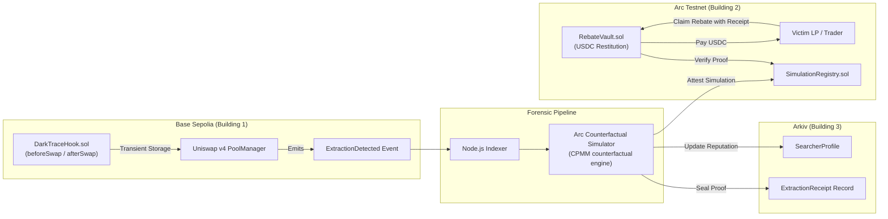

# DarkTrace

> **"LPs are losing $1B+ annually to MEV (over $1 billion annually by conservative estimates[^1]). DarkTrace gives it back, and proves it on-chain."**

DarkTrace is MEV forensics for Uniswap v4 LPs: hooks detect extraction footprints, Arkiv seals the immutable proof receipt, and LPs claim USDC rebates on Arc Testnet. By separating extraction fingerprinting on-chain from deterministic counterfactual computation off-chain, DarkTrace delivers transparent restitution without interfering with trade execution or inventing synchronous cross-chain assumptions.

[^1]: LVR/MEV loss estimates vary by methodology; see Flashbots/RAMS and Dune MEV dashboards. DarkTrace uses 'over $1B annually' as a conservative floor, not a canonical figure.

---

## Architecture



---

## Deployed Addresses & Contracts

| Network | Contract / Component | Address | Description |
| :--- | :--- | :--- | :--- |
| **Base Sepolia** | Uniswap v4 `PoolManager` | `0x05E73354cFDd6745C338b50BcFDfA3Aa6fA03408` | Canonical v4 Pool Manager |
| **Base Sepolia** | `DarkTraceHook` | `0xBCC9e1C474Ed195b3791f2c41EdAC2a25c5b80c0` | Hook with `0x00C0` (`beforeSwap`/`afterSwap`) flags |
| **Base Sepolia** | `SearcherRegistry` | `0x24A2669C706CCE71BAea24a4De18D9D215713551` | Searcher bond escrow and governance slashing |
| **Arc Testnet** | `SimulationRegistry` | `0xb8416cb4d82BA72b70C3EC55d7AC66b5DB415CF8` | Attestation registry for counterfactual proofs |
| **Arc Testnet** | `RebateVault` | `0x2ab745F51002Ce236A9A2dA81cDaA553B87f28CD` | Restitution vault funded with USDC for LP rebates |
| **Arc Testnet** | `Arc Native USDC (ERC-20)`| `0x3600000000000000000000000000000000000000` | Native 6-decimal USDC interface on Arc |
| **Arkiv Ledger** | Namespace / Schemas | `darktrace.v1` | `ExtractionReceipt`, `SearcherProfile`, `LPClaim` |

---

## Local Development Quickstart

### Prerequisites
- Node.js >= 20.x, `pnpm` >= 9.x
- Foundry (`forge`, `cast`, `anvil`)
- Docker & Docker Compose (optional for simulator daemon)

### Commands
```bash
# 1. Install dependencies
pnpm install

# 2. Run Foundry smart contract tests
pnpm contracts:test

# 3. Start local Next.js frontend
pnpm dev

# 4. Optional: Run local background indexer
pnpm --filter @darktrace/indexer dev
```

---

## How the Demo Works

Visit `/demo` in the web application for an interactive walkthrough:
1. **Trigger Sandwich**: Simulates a frontrun, victim swap, and backrun sequence against the Uniswap v4 pool.
2. **Forensic Fingerprint**: The hook records the transient storage imbalance and emits `ExtractionDetected`.
3. **Counterfactual Engine**: Computes exact `injectedSlippageBps` versus `legitSlippageBps` by replaying against pre-attack reserves.
4. **Arkiv Attestation**: Seals an immutable `ExtractionReceipt`.
5. **Rebate Claim**: The LP signs a claim against `RebateVault.sol` on Arc Testnet, receiving USDC restitution directly.

---

## Testnet Disclaimer

All contracts, tokens, and data feeds operate strictly on Base Sepolia and Arc Testnet environments. No real user funds or production mainnet assets are involved.

---

## Specification Documents

Comprehensive specifications are maintained in `/specs`:
- [`00-plan.md`](specs/00-plan.md): Master hackathon execution plan.
- [`01-architecture.md`](specs/01-architecture.md): Full technical architecture and boundary guarantees.
- [`02-hook-design.md`](specs/02-hook-design.md): Uniswap v4 hook transient storage specification.
- [`03-arc-simulator.md`](specs/03-arc-simulator.md): Counterfactual LVR mathematical specification.
- [`04-arkiv-schema.md`](specs/04-arkiv-schema.md): Arkiv JSON-LD forensic schema.
- [`05-ui-ux.md`](specs/05-ui-ux.md): Forensic terminal styling guidelines.
- [`06-demo-script.md`](specs/06-demo-script.md): 3-minute video presentation script.
- [`07-deployment.md`](specs/07-deployment.md): Reproducible deployment instructions.

---

## AI Attribution

In compliance with ETHGlobal Mumbai 2026 transparency standards, all contributions are audited in [`AI_ATTRIBUTION.md`](AI_ATTRIBUTION.md).

---

## License

[MIT](LICENSE) © 2026 DarkTrace Contributors

