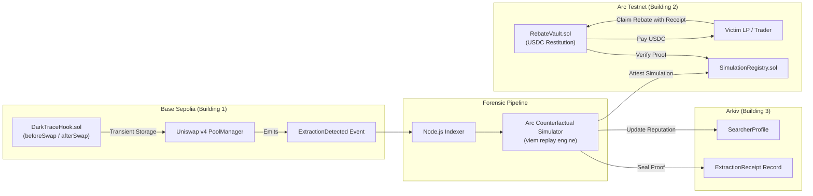

# DarkTrace

> **"LPs are losing $1.2B to MEV. DarkTrace gives it back, and proves it on-chain."**

DarkTrace is MEV forensics for Uniswap v4 LPs: hooks detect extraction footprints, Arkiv seals the immutable proof receipt, and LPs claim USDC rebates on Arc Testnet. By separating extraction fingerprinting on-chain from deterministic counterfactual simulation off-chain, DarkTrace delivers transparent restitution without interfering with trade execution or inventing synchronous cross-chain assumptions.

---

## Architecture



---

## Deployed Addresses

| Network | Contract / Component | Address |
| :--- | :--- | :--- |
| **Base Sepolia** | Uniswap v4 `PoolManager` | `0x05FF2B0E24E15B20C9Ed8704337ca525Bc3095F6` |
| **Base Sepolia** | `DarkTraceHook` | `[Deploying in Stage 2]` |
| **Base Sepolia** | `SearcherRegistry` | `[Deploying in Stage 2]` |
| **Arc Testnet** | `SimulationRegistry` | `[Deploying in Stage 4]` |
| **Arc Testnet** | `RebateVault` (USDC) | `[Deploying in Stage 4]` |
| **Arkiv** | Namespace / Schema | `darktrace.v1.extractions` |

---

## Local Development Quickstart

### Prerequisites
- Node.js >= 20.x, `pnpm` >= 9.x
- Foundry (`forge`, `cast`, `anvil`)
- Docker & Docker Compose (optional for simulator daemon)

### Commands
```bash
# 1. Install dependencies
pnpm install

# 2. Run Foundry smart contract tests
pnpm contracts:test

# 3. Start local Next.js frontend
pnpm dev

# 4. Optional: Run local background indexer
pnpm --filter @darktrace/indexer dev
```

---

## How the Demo Works

Visit `/demo` in the web application for an interactive walkthrough:
1. **Trigger Sandwich**: Simulates a frontrun, victim swap, and backrun sequence against the Uniswap v4 pool.
2. **Forensic Fingerprint**: The hook records the transient storage imbalance and emits `ExtractionDetected`.
3. **Counterfactual Engine**: Computes exact `injectedSlippageBps` versus `legitSlippageBps` by replaying against pre-attack reserves.
4. **Arkiv Attestation**: Seals an immutable `ExtractionReceipt`.
5. **Rebate Claim**: The LP signs a claim against `RebateVault.sol` on Arc Testnet, receiving USDC restitution directly.

---

## Testnet Disclaimer

All contracts, tokens, and data feeds operate strictly on Base Sepolia and Arc Testnet environments. No real user funds or production mainnet assets are involved.

---

## Specification Documents

Comprehensive specifications are maintained in `/specs`:
- [`00-plan.md`](specs/00-plan.md): Master hackathon execution plan.
- [`01-architecture.md`](specs/01-architecture.md): Full technical architecture and boundary guarantees.
- `02-hook-design.md`: Uniswap v4 hook transient storage specification (Stage 2).
- `03-arc-simulator.md`: Counterfactual LVR mathematical specification (Stage 4).
- `04-arkiv-schema.md`: Arkiv JSON-LD forensic schema (Stage 3).
- `05-ui-ux.md`: Forensic terminal styling guidelines (Stage 6).
- `06-demo-script.md`: 3-minute video presentation script (Stage 8).
- `07-deployment.md`: Reproducible deployment instructions (Stage 8).

---

## AI Attribution

In compliance with ETHGlobal Mumbai 2026 transparency standards, all contributions are audited in [`AI_ATTRIBUTION.md`](AI_ATTRIBUTION.md).

---

## License

[MIT](LICENSE) © 2026 DarkTrace Contributors

