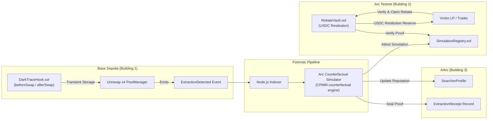

# DarkTrace

> **"LPs are losing $1B+ annually to MEV (over $1 billion annually by conservative estimates[^1]). DarkTrace gives it back, and proves it on-chain."**

DarkTrace is MEV forensics for Uniswap v4 LPs: hooks detect extraction footprints, Arkiv seals the immutable proof receipt, and LPs claim USDC rebates on Arc Testnet. By separating extraction fingerprinting on-chain from deterministic counterfactual computation off-chain, DarkTrace delivers transparent restitution without interfering with trade execution or inventing synchronous cross-chain assumptions.

[^1]: LVR/MEV loss estimates vary by methodology; see Flashbots/RAMS and Dune MEV dashboards. DarkTrace uses 'over $1B annually' as a conservative floor, not a canonical figure.

---

## Architecture



---

## Deployed Addresses & Contracts

| Network | Contract / Component | Address | Description |
| :--- | :--- | :--- | :--- |
| **Base Sepolia** | Uniswap v4 `PoolManager` | `0x05E73354cFDd6745C338b50BcFDfA3Aa6fA03408` | Canonical v4 Pool Manager |
| **Base Sepolia** | `DarkTraceHook` | `0xBCC9e1C474Ed195b3791f2c41EdAC2a25c5b80c0` | Hook with `0x00C0` (`beforeSwap`/`afterSwap`) flags |
| **Base Sepolia** | `SearcherRegistry` | `0x24A2669C706CCE71BAea24a4De18D9D215713551` | Searcher bond escrow and governance slashing |
| **Arc Testnet** | `SimulationRegistry` (Foundry) | `0xb8416cb4d82BA72b70C3EC55d7AC66b5DB415CF8` | Attestation registry for counterfactual proofs |
| **Arc Testnet** | `RebateVault` (Foundry) | `0x2ab745F51002Ce236A9A2dA81cDaA553B87f28CD` | Active settlement vault funded with 5.00 USDC reserve |
| **Arc Testnet** | `SimulationRegistry` (Arc Studio) | `0x52794Da13E573c9e73D32248a286843418Ba2983` | Studio deployment (60/60 passing tests) |
| **Arc Testnet** | `RebateVault` (Arc Studio) | `0x676065eb7c72ddf2048f21e6cb2ca6721827c1de` | Studio provenance contract with advanced stablecoin logic |
| **Arc Testnet** | `Arc Native USDC (ERC-20)`| `0x3600000000000000000000000000000000000000` | Native 6-decimal USDC interface on Arc |
| **Arkiv (rabdi, 7794095)** | Namespace | `darktrace.v1` | `ExtractionReceipt` / `SearcherProfile` / `LPClaim` |
| **Arkiv (rabdi, 7794095)** | Sample entity key | `0xc327d5db4aa3098b80dc8729d090317408f98d19e1e19c13d6cf83494a05f8ca` | Verified on `rabdi.explorer.arkiv.network` |

---

## Arkiv Integration (rabdi testnet, chain 7794095)

- **Namespace**: `darktrace.v1`
- **Writer wallet(s)**: `0xb491fe5846DE735B6Cb03a677A3C6296FAB0aDA5`
- **Entities**: `ExtractionReceipt`, `SearcherProfile`, `LPClaim`
- **Canonical receiptHash**: `0xe9e56b6adbf0cae90f08b28a0ae3dccd9fc4ece42eb7b0126e4f208646eae6ce` (stored as attribute inside `$key` `0xc327...`)
- **Schema + freshness + expiry policy**: see [`/arkiv/schema.md`](./arkiv/schema.md)
- **Feedback**: see [`/arkiv/friction.md`](./arkiv/friction.md)
- **Reproducible verification query** (run from any machine with `ARKIV_RPC_URL` set to `https://rpc.rabdi.db-chain.testnet.arkiv.network`):

  ```typescript
  import { createPublicClient, http } from "viem";
  import { createPublicClient as createArkivClient } from "@arkiv-network/sdk";
  import { rabdi } from "@arkiv-network/sdk/chains";
  import { eq } from "@arkiv-network/sdk/query";

  const client = createArkivClient({
    chain: rabdi({ accessKey: process.env.ARKIV_ACCESS_KEY }),
    transport: http(),
  });

  const res = await client
    .select({
      $key: true,
      $owner: true,
      receiptHash: true,
      poolId: true,
      searcher: true,
      victim: true,
      extractedUSDC: true,
    })
    .where(eq("$key", "0xc327d5db4aa3098b80dc8729d090317408f98d19e1e19c13d6cf83494a05f8ca"))
    .fetch();

  console.log("Verified entity:", res.entities[0]);
  ```

- **Explorer link to live entity**:
  [https://rabdi.explorer.arkiv.network/entity/0xc327d5db4aa3098b80dc8729d090317408f98d19e1e19c13d6cf83494a05f8ca](https://rabdi.explorer.arkiv.network/entity/0xc327d5db4aa3098b80dc8729d090317408f98d19e1e19c13d6cf83494a05f8ca)

- **Sanity check**: `pnpm arkiv:write-test` writes and reads back one receipt on Rabdi testnet.

---

## Local Development Quickstart

### Prerequisites
- Node.js >= 20.x, `pnpm` == 9.1.4
- Foundry (`forge`, `cast`, `anvil`)
- Docker & Docker Compose (optional for containerized indexer daemon)

### Commands
```bash
# 1. Install dependencies deterministically
pnpm install --frozen-lockfile

# 2. Run Foundry smart contract tests
pnpm contracts:test

# 3. Run TypeScript test suites (simulator, arkiv, indexer)
pnpm test

# 4. Start local Next.js web application
pnpm dev

# 5. Optional: Run indexer daemon in Docker
docker compose build
docker compose up -d
curl http://localhost:8080/health
docker compose down
```

---

## How the Demo Works

Visit `/demo` in the web application for an interactive forensic walkthrough:
1. **Trigger Sandwich**: Replays a 3-tx sandwich sequence (frontrun swap, victim swap, backrun swap) against Uniswap v4.
2. **Forensic Fingerprint**: The hook observes the transient tick inversion and emits `ExtractionDetected`.
3. **Counterfactual Engine**: Decomposes gross observed slippage into normal liquidity slippage (`12 bps`) and injected MEV slippage (`175 bps`), calculating the exact victim restitution ($1.25 USDC).
4. **Arkiv Attestation**: Seals an immutable `ExtractionReceipt` into the proof ledger.
5. **Rebate Claim**: The LP previews restitution against `RebateVault.sol` on Arc Testnet; the interactive demo simulates settlement in the frontend without broadcasting unverified transactions.

---

## Testnet Disclaimer

All contracts, tokens, and data feeds operate strictly on Base Sepolia and Arc Testnet environments. No real user funds or production mainnet assets are involved.

---

## Submission Artifacts & Evidence

- **Link Audit & Verification Matrix**: [`docs/evidence/link-audit.md`](docs/evidence/link-audit.md)
- **Visual Evidence & Screenshots**: [`docs/screenshots/README.md`](docs/screenshots/README.md)
- **Uniswap Foundation Feedback**: [`FEEDBACK.md`](FEEDBACK.md)
- **Arc Studio Package & Test Report**: [`arc-studio/report.md`](arc-studio/report.md)
- **Arkiv Integration Package**: [`arkiv/README.md`](arkiv/README.md)
- **Final Submission Checklist**: [`specs/submission/FINAL-SUBMISSION-CHECKLIST.md`](specs/submission/FINAL-SUBMISSION-CHECKLIST.md)

---

## Specification Documents

Comprehensive specifications are maintained in `/specs`:
- [`00-plan.md`](specs/00-plan.md): Master hackathon execution plan.
- [`01-architecture.md`](specs/01-architecture.md): Full technical architecture and boundary guarantees.
- [`02-hook-design.md`](specs/02-hook-design.md): Uniswap v4 hook transient storage specification.
- [`03-arc-simulator.md`](specs/03-arc-simulator.md): Counterfactual LVR mathematical specification.
- [`04-arkiv-schema.md`](specs/04-arkiv-schema.md): Arkiv JSON-LD forensic schema.
- [`05-ui-ux.md`](specs/05-ui-ux.md): Forensic terminal styling guidelines.
- [`06-demo-script.md`](specs/06-demo-script.md): 3-minute video presentation script.
- [`07-deployment.md`](specs/07-deployment.md): Reproducible deployment instructions.

---

## AI Attribution

In compliance with ETHGlobal Mumbai 2026 transparency standards, all contributions are audited in [`AI_ATTRIBUTION.md`](AI_ATTRIBUTION.md).

---

## License

[MIT](LICENSE) © 2026 DarkTrace Contributors
