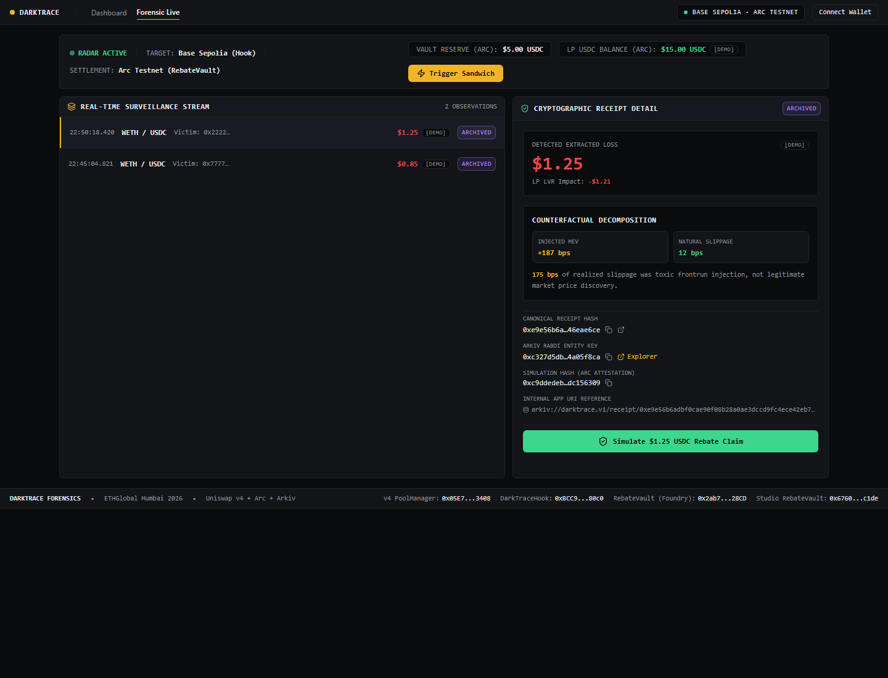
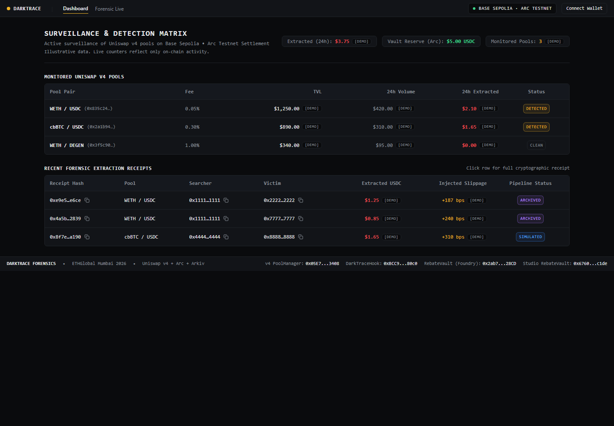
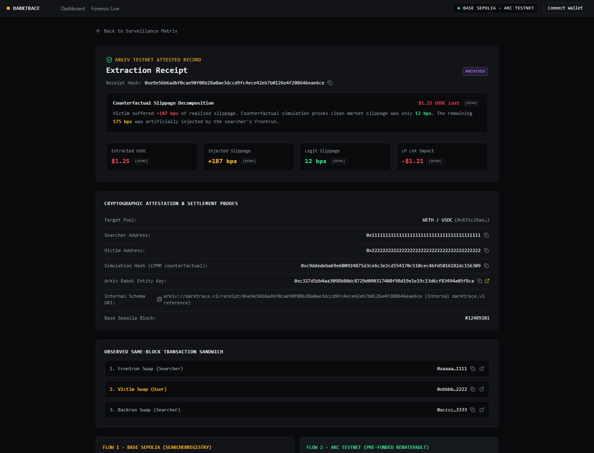

# DarkTrace Visual Evidence & Screenshot Catalog

This catalog documents the visual and structural evidence of the DarkTrace system across the Uniswap v4 hook, Arc Testnet USDC vault, Arkiv Rabdi ledger, and live web application.

---

## 1. Application Interface Views (Live Hosted on Vercel)

### A. Interactive Forensic Terminal (`/demo`)

- **URL**: [https://darktrace-lovat.vercel.app/demo](https://darktrace-lovat.vercel.app/demo)
- **Key Visual Evidence**:
  - Split-view layout: Live Uniswap v4 Sandwich stream on left; cryptographic receipt & counterfactual decomposition on right.
  - Mathematical slippage decomposition: Injected MEV (`+187 bps`) vs Natural Market Slippage (`12 bps`).
  - Net toxic frontrun injection verified: `175 bps`.
  - Canonical `receiptHash` (`0xe9e5...`) and Arkiv Rabdi Entity Key (`0xc327...`) with 1-click explorer link.
  - Interactive simulated settlement button (`Simulate $1.25 USDC Rebate Claim`).

### B. Forensics Surveillance Matrix (`/dashboard`)

- **URL**: [https://darktrace-lovat.vercel.app/dashboard](https://darktrace-lovat.vercel.app/dashboard)
- **Key Visual Evidence**:
  - Active Uniswap v4 monitored pools (`WETH / USDC`, `cbBTC / USDC`, `WETH / DEGEN`).
  - Live on-chain Arc Vault Reserve counter (`$5.00 USDC` in Foundry Vault `0x2ab7...28CD`).
  - 24h extracted loss totals and recent cryptographic extraction receipts with pipeline status badges (`ARCHIVED`, `SIMULATED`).

### C. Cryptographic Extraction Receipt (`/receipt/0xe9e5...`)

- **URL**: [https://darktrace-lovat.vercel.app/receipt/0xe9e56b6adbf0cae90f08b28a0ae3dccd9fc4ece42eb7b0126e4f208646eae6ce](https://darktrace-lovat.vercel.app/receipt/0xe9e56b6adbf0cae90f08b28a0ae3dccd9fc4ece42eb7b0126e4f208646eae6ce)
- **Key Visual Evidence**:
  - Full attestation record showing victim loss (`$1.25 USDC`) and LP LVR impact (`-$1.21`).
  - Observed 3-transaction same-block sandwich sequence (Frontrun Swap -> Victim Swap -> Backrun Swap).
  - Explicit separation between Flow 1 (Base Sepolia `SearcherRegistry`) and Flow 2 (Arc Testnet `RebateVault`).

---

## 2. On-Chain & Explorer Evidence

### D. Uniswap v4 Hook on Base Sepolia
- **Address**: `0xBCC9e1C474Ed195b3791f2c41EdAC2a25c5b80c0`
- **Explorer**: [https://sepolia.basescan.org/address/0xBCC9e1C474Ed195b3791f2c41EdAC2a25c5b80c0](https://sepolia.basescan.org/address/0xBCC9e1C474Ed195b3791f2c41EdAC2a25c5b80c0)
- **Verification**: Salt `0x139d` mined against CREATE2 deployer, fulfilling Uniswap v4 hook permissions `0x00C0` (`beforeSwap` and `afterSwap`).

### E. Arc Testnet Rebate Vault (Foundry Deployment)
- **Address**: `0x2ab745F51002Ce236A9A2dA81cDaA553B87f28CD`
- **Explorer**: [https://explorer.testnet.arc.io/address/0x2ab745F51002Ce236A9A2dA81cDaA553B87f28CD](https://explorer.testnet.arc.io/address/0x2ab745F51002Ce236A9A2dA81cDaA553B87f28CD)
- **Verification**: Verified on-chain balance of `5.00 USDC` (`5,000,000` raw units) funded via transaction `0x4289870dba2b919eac9e654e853ff45f38a03bb9a66e0be3d6da8d8e07deab9d`.

### F. Arc Studio Contract Suite & Test Evidence
- **Report**: [`arc-studio/report.md`](../../arc-studio/report.md)
- **Verification**: 60 out of 60 unit, fuzz, reentrancy, and invariant tests passing inside Arc Studio, validating advanced stablecoin logic, `RebateVault.sol`, and `SimulationRegistry.sol`.

### G. Arkiv Rabdi Testnet Verified Ledger Entity
- **Entity Key (`$key`)**: `0xc327d5db4aa3098b80dc8729d090317408f98d19e1e19c13d6cf83494a05f8ca`
- **Receipt Hash**: `0xe9e56b6adbf0cae90f08b28a0ae3dccd9fc4ece42eb7b0126e4f208646eae6ce`
- **Explorer**: [https://rabdi.explorer.arkiv.network/entity/0xc327d5db4aa3098b80dc8729d090317408f98d19e1e19c13d6cf83494a05f8ca](https://rabdi.explorer.arkiv.network/entity/0xc327d5db4aa3098b80dc8729d090317408f98d19e1e19c13d6cf83494a05f8ca)
- **Write Transaction**: `0x544ee730bb736cdbafcd837bad62f857c8ed0e0eaedf7afce807ffb060c6e0f6`
- **Verification**: Fully queryable entity confirmed via SDK write/read roundtrip (`pnpm arkiv:write-test`).
