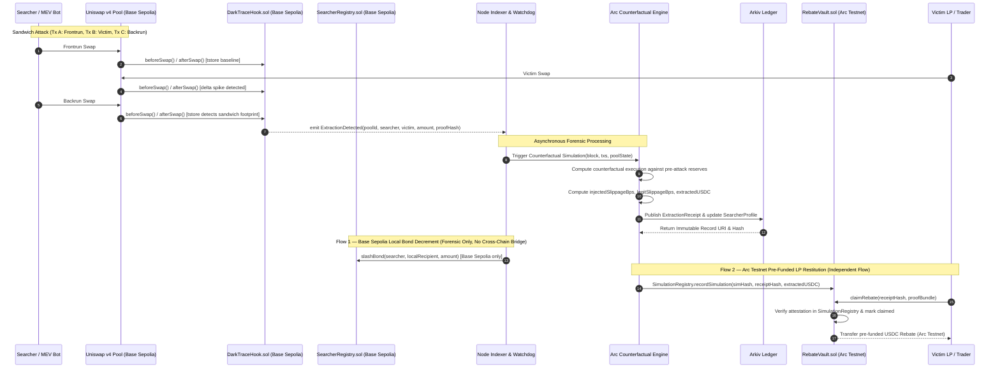

# DarkTrace — System Architecture Specification

## 1. High-Level System Architecture

DarkTrace bridges three autonomous systems to detect, prove, and settle MEV extraction restitution for Uniswap v4 Liquidity Providers.



---

## 2. The Three Buildings

### Building 1: Uniswap v4 Hook (`DarkTraceHook.sol`)
- **Network**: Base Sepolia (or Unichain Sepolia).
- **Hooks Activated**: `beforeSwap` and `afterSwap`.
- **Transient Storage Pattern (`tstore` / `tload`)**:
  - `SLOT_LAST_SWAP_TICK`: Stores the pool tick immediately preceding the current swap.
  - `SLOT_TX_ORIGIN`: Identifies `tx.origin` and initiator to map adjacent transactions in the same block.
  - `SLOT_BLOCK_SWAP_COUNT`: Tracks intraday/intra-block swap counters for the specific pool.
- **Detection Heuristic**:
  - Monitors high-frequency tick inversion (large push in direction $D_1$, followed by user swap, followed immediately by push in direction $D_2 = -D_1$).
  - Distinguishes legitimate market slippage from artificial sandwich distortion by checking block-local volume delta and adjacent sender behavior.
  - Emits:
    ```solidity
    event ExtractionDetected(
        PoolId indexed poolId,
        address indexed searcher,
        address indexed victim,
        uint256 estimatedExtractedUSDC,
        bytes32 proofHash
    );
    ```

### Building 2: Arc L1 Counterfactual Simulator & Rebate Vault
- **Network**: Arc Testnet (Circle's USDC-native L1).
- **Core Engine (`lib/simulator/counterfactual.ts`)**:
  - Takes block snapshot immediately before the searcher's frontrun transaction ($S_{t-1}$).
  - Runs pure victim swap without the frontrun against virtual reserves.
  - Calculates:
    - $\text{ExecutionPrice}_{\text{actual}}$ vs $\text{ExecutionPrice}_{\text{counterfactual}}$.
    - $\text{LegitimateSlippage} = \frac{|\text{Price}_{\text{clean}} - \text{Price}_{\text{pre}}|}{\text{Price}_{\text{pre}}}$.
    - $\text{InjectedMEVSlippage} = \frac{|\text{Price}_{\text{actual}} - \text{Price}_{\text{clean}}|}{\text{Price}_{\text{clean}}}$.
    - $\text{ExtractedUSDC} = (\text{InjectedMEVSlippage}) \times \text{Volume}_{\text{victim}}$.
    - $\text{LP\_LVR\_delta} = \text{Loss incurred by LPs due to toxic arbitrage}$.
- **Contracts on Arc**:
  - `SimulationRegistry.sol`: Admin/worker authenticated registry storing verifiable `(simulationHash, receiptHash, extractedUSDC, blockNumber)`.
  - `RebateVault.sol`: Holds pre-funded USDC deposited on Arc Testnet via protocol reserves or sponsor seeding (independent of Base Sepolia searcher bonds). Allows victims or affected LPs to execute `claimRebate(...)` verified against `SimulationRegistry`. Prevents double-claims via nullifier mapping `mapping(bytes32 => bool) public claimedReceipts`.

### Building 3: Arkiv Decentralized Forensic Ledger
- **Role**: Permanent, tamper-evident proof ledger for decentralized auditing and searcher credit scoring.
- **Records**:
  1. `ExtractionReceipt`:
     ```typescript
     interface ExtractionReceipt {
       v: "1.0.0";
       receiptHash: string; // keccak256 canonical hash
       poolId: string;
       searcher: string;
       victim: string;
       lp: string;
       blockNumber: number;
       extractedUSDC: string;
       injectedSlippageBps: number;
       legitSlippageBps: number;
       simulationHash: string;
       txHashes: string[];
       createdAt: number;
     }
     ```
  2. `SearcherProfile`:
     ```typescript
     interface SearcherProfile {
       v: "1.0.0";
       searcher: string;
       extractionsCount: number;
       totalExtractedUSDC: string;
       bondedUSDC: string;
       slashedUSDC: string;
       lastSeenBlock: number;
     }
     ```
  3. `LPClaim`:
     ```typescript
     interface LPClaim {
       v: "1.0.0";
       receiptHash: string;
       lp: string;
       claimTx: string;
       amountUSDC: string;
       createdAt: number;
     }
     ```

---

## 3. Strict Boundary Guarantees (What DarkTrace Does NOT Do)

1. **No Synchronous Cross-Chain Execution**:
   - The Base Sepolia hook does NOT call Arc in the same transaction. That is physically impossible across disparate chains.
2. **No Same-Block Rebates**:
   - Restitution settlement happens asynchronously on Arc after off-chain indexers and counterfactual engines verify block finality.
3. **No Swap Reversion or Blocking**:
   - DarkTrace does not break Uniswap v4 routing by arbitrarily reverting user transactions. Swaps execute freely; forensics and economic restitution happen post-block.
4. **No Phantom Sequencer Slashing**:
   - DarkTrace slashes bonded searchers who have committed stake to `SearcherRegistry.sol`. It does not claim to slash L2 sequencers or protocol validators.

---

## 4. Security & Integrity Model

- **Replay Protection**: Every `receiptHash` can only be redeemed once in `RebateVault.sol`.
- **Simulation Attestation**: The `RebateVault` accepts claims only when the `receiptHash` matches a registered, authenticated record in `SimulationRegistry`.
- **Transient Safety**: The hook uses Solidity 0.8.24 transient storage instructions (`tstore`/`tload`) cleared at the end of the transaction execution, preventing reentrancy storage pollution.
- **Fail-Safe Heuristics**: If market volatility creates false-positive anomalies, the counterfactual simulator serves as the ground-truth verification layer. If `injectedSlippageBps == 0`, no extraction is recorded in `SimulationRegistry`.

